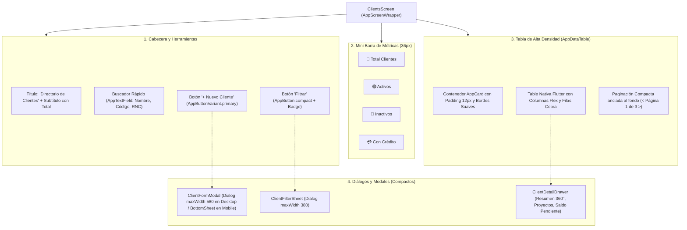

# Especificación de UI y Lógica de Negocio: Módulo de Clientes

Este documento define la arquitectura integral para el módulo de **Clientes** de la plataforma Neo Project ERP, abarcando la lógica de negocio, modelo de datos, contratos de API REST (payloads de envío y recepción) y el diseño de la interfaz de usuario (UI/UX) basado en el sistema de componentes ultra-compactos (**flutter-small-widgets**).

---

## 1. Lógica de Negocio y Entidad Cliente

El cliente representa a la persona física o jurídica para la cual se ejecutan proyectos, se generan cotizaciones y se registran cuentas por cobrar (CXC).

### 1.1 Atributos del Modelo

| Campo en DB | Tipo SQL | Tipo Dart | Requerido | Validación / Reglas | Descripción |
| :--- | :--- | :--- | :--- | :--- | :--- |
| `id` | `BIGINT UNSIGNED` | `int?` | Automático | Primary Key | Identificador interno único autoincremental. |
| `code` | `VARCHAR(255)` | `String` | **Sí** | `unique:clients,code` | Código corporativo único (ej: `CLI-001`, `CLI-849201`). |
| `type` | `ENUM` | `String` | **Sí** | `in:persona_fisica,empresa,gobierno,institucion` | Tipo fiscal/organizacional del cliente. |
| `name` | `VARCHAR(255)` | `String` | **Sí** | `max:255` | Nombre completo o Razón Social oficial. |
| `commercial_name` | `VARCHAR(255)` | `String?` | No | `max:255` | Nombre comercial o marca de cara al público. |
| `document_number` | `VARCHAR(50)` | `String?` | No | `max:50` | Cédula de identidad (11 dígitos) o RNC (9 dígitos). |
| `contact_name` | `VARCHAR(255)` | `String?` | No | `max:255` | Nombre del representante o enlace de contacto directo. |
| `contact_position`| `VARCHAR(255)` | `String?` | No | `max:255` | Cargo o puesto del contacto (ej: Administrador, Gerente). |
| `phone` | `VARCHAR(50)` | `String?` | No | `max:50` | Teléfono fijo corporativo. |
| `mobile` | `VARCHAR(50)` | `String?` | No | `max:50` | Número de teléfono móvil principal. |
| `whatsapp` | `VARCHAR(50)` | `String?` | No | `max:50` | Línea de mensajería instantánea para notificaciones. |
| `email` | `VARCHAR(255)` | `String?` | No | `email, max:255` | Correo electrónico corporativo o de facturación. |
| `country` | `VARCHAR(100)` | `String?` | No | Default: `República Dominicana` | País de radicación del cliente. |
| `province` | `VARCHAR(100)` | `String?` | No | `max:100` | Provincia o estado (ej: Santiago, Santo Domingo). |
| `city` | `VARCHAR(100)` | `String?` | No | `max:100` | Ciudad o municipio (ej: Moca, Santiago de los Caballeros). |
| `sector` | `VARCHAR(100)` | `String?` | No | `max:100` | Sector o barrio residencial/industrial. |
| `address` | `TEXT` | `String?` | No | `nullable` | Dirección física detallada (calle, número, edificio). |
| `credit_limit` | `DECIMAL(15,2)` | `double` | No | `numeric, min:0` (Default: `0.00`) | Monto máximo de crédito autorizado en RD$. |
| `credit_days` | `INT` | `int` | No | `integer, min:0` (Default: `0`) | Días calendario de crédito otorgados (plazo de pago). |
| `classification` | `ENUM` | `String` | No | `in:excelente,bueno,regular,riesgoso` | Calificación de cumplimiento comercial. |
| `active` | `BOOLEAN` | `bool` | No | Default: `true` | Estado operativo del cliente (Activo/Inactivo). |
| `notes` | `TEXT` | `String?` | No | `nullable` | Observaciones especiales, referencias o acuerdos. |
| `created_at` | `TIMESTAMP` | `DateTime?` | Automático | Eloquent timestamps | Fecha de creación del registro. |
| `updated_at` | `TIMESTAMP` | `DateTime?` | Automático | Eloquent timestamps | Última actualización. |
| `deleted_at` | `TIMESTAMP` | `DateTime?` | Automático | SoftDeletes | Borrado lógico sin pérdida histórica. |

---

### 1.2 Reglas de Negocio Clave

1. **Unicidad de Código**: El campo `code` no se puede duplicar en clientes activos ni eliminados (salvo soft delete purgado). Se puede autogenerar como `CLI-XXXXXX` si el usuario no especifica uno.
2. **Control de Crédito**:
   - Si `credit_limit == 0` o `credit_days == 0`, el cliente opera en modalidad **Contado** ("Sin Crédito").
   - Si `credit_limit > 0`, el sistema habilitará facturación a crédito y control de vencimiento según `credit_days`.
3. **Jerarquía Visual de Clasificación**:
   - `excelente` / `bueno`: Distintivo verde (`#16A34A`).
   - `regular`: Distintivo ámbar (`#EA580C`).
   - `riesgoso`: Distintivo rojo (`#DC2626`).
4. **Relaciones en el ERP**:
   - **Proyectos (`proyectos.client_id`)**: Un cliente puede tener múltiples proyectos u obras en ejecución.
   - **Cuentas por Cobrar (`pagos_clientes`)**: Registro de recibos de cobro asociados a facturas y proyectos del cliente.

---

## 2. Contrato de API REST (Backend Laravel)

Ruta base: `/api/clients`  
Autenticación: `Bearer Token` (`auth:sanctum`)

### 2.1 Endpoints Disponibles

| Método | Endpoint | Acción | Parámetros Query |
| :--- | :--- | :--- | :--- |
| `GET` | `/api/clients` | Listado filtrado | `search`, `type`, `classification`, `active` |
| `POST` | `/api/clients` | Crear nuevo cliente | N/A (Body JSON) |
| `GET` | `/api/clients/{id}` | Obtener detalle | N/A |
| `PUT` | `/api/clients/{id}` | Actualizar cliente | N/A (Body JSON) |
| `POST` | `/api/clients/{id}/toggle-active` | Alternar estado activo/inactivo | N/A |

---

### 2.2 Payload Enviado a la API (`POST /api/clients` y `PUT /api/clients/{id}`)

```json
{
  "code": "CLI-204918",
  "type": "empresa",
  "name": "CONSTRUCTORA PLAZA MOCA S.R.L.",
  "commercial_name": "PLAZA MOCA",
  "document_number": "131167993",
  "contact_name": "Ing. Carlos Mendoza",
  "contact_position": "Gerente de Compras",
  "phone": "809-578-2233",
  "mobile": "829-555-0199",
  "whatsapp": "829-555-0199",
  "email": "cmendoza@plazamoca.com.do",
  "country": "República Dominicana",
  "province": "Espaillat",
  "city": "Moca",
  "sector": "Villa Estela",
  "address": "Calle Independencia #45, Edif. Plaza Central, Suite 3B",
  "credit_limit": 500000.00,
  "credit_days": 30,
  "classification": "excelente",
  "active": true,
  "notes": "Cliente corporativo preferencial. Facturar siempre con comprobante de Crédito Fiscal (B01)."
}
```

---

### 2.3 Respuesta Exitosa de la API (`HTTP 200 / 201 Created`)

```json
{
  "id": 14,
  "code": "CLI-204918",
  "type": "empresa",
  "name": "CONSTRUCTORA PLAZA MOCA S.R.L.",
  "commercial_name": "PLAZA MOCA",
  "document_number": "131167993",
  "contact_name": "Ing. Carlos Mendoza",
  "contact_position": "Gerente de Compras",
  "phone": "809-578-2233",
  "mobile": "829-555-0199",
  "whatsapp": "829-555-0199",
  "email": "cmendoza@plazamoca.com.do",
  "country": "República Dominicana",
  "province": "Espaillat",
  "city": "Moca",
  "sector": "Villa Estela",
  "address": "Calle Independencia #45, Edif. Plaza Central, Suite 3B",
  "credit_limit": "500000.00",
  "credit_days": 30,
  "classification": "excelente",
  "active": true,
  "notes": "Cliente corporativo preferencial. Facturar siempre con comprobante de Crédito Fiscal (B01).",
  "created_at": "2026-11-24T17:40:12.000000Z",
  "updated_at": "2026-11-24T17:40:12.000000Z",
  "deleted_at": null
}
```

---

### 2.4 Respuesta de Error de Validación (`HTTP 422 Unprocessable Entity`)

```json
{
  "message": "The code has already been taken. (and 1 more error)",
  "errors": {
    "code": [
      "El código ya está en uso por otro cliente."
    ],
    "name": [
      "El campo nombre o razón social es obligatorio."
    ]
  }
}
```

---

## 3. Especificación y Modelo de la UI (Pantalla de Clientes)

La interfaz se rediseña siguiendo las directrices de `flutter-small-widgets` y la arquitectura modular probada en **Proveedores** y **Compras**. Se eliminan las tarjetas cuadradas grandes en favor de una tabla de alta densidad y rendimiento.



---

### 3.1 Anatomía de Componentes en Pantalla

#### A. Barra Superior y Herramientas
- **Título**: `Directorio de Clientes` (18px, bold, color `#0F172A`).
- **Subtítulo**: `X clientes encontrados` (11.5px, color `#64748B`).
- **Buscador en la misma fila**:
  - `SizedBox(width: 260)` con `AppTextField(hintText: 'Buscar por nombre, código o RNC...')`.
  - Icono de lupa integrado y botón de limpiar `Icons.clear` cuando tiene texto.
- **Botón Filtrar**:
  - `AppButton.compact(text: 'Filtrar', icon: Icons.tune_rounded)` ubicado inmediatamente al lado del buscador.
- **Botón Principal**:
  - `AppButton(text: 'Nuevo Cliente', icon: Icons.add_rounded, variant: AppButtonVariant.primary)` en rojo institucional.

#### B. Barra Métrica Compacta (Altura: 36px)
Reemplaza las tarjetas altas por una barra horizontal con chips de datos:
- `👥 45 Clientes` (Gris Pizarra `#64748B`)
- `🟢 42 Activos` (Verde Esmeralda `#16A34A`)
- `🔴 3 Inactivos` (Rojo Carmesí `#DC2626`)
- `💳 18 Con Crédito` (Ámbar Dorado `#D97706`)

#### C. Tabla Principal (`AppDataTable`)
- **Contenedor**: Envuelto en `AppCard` con padding interno de `12px` y borde redondeado (`borderRadius: 8`, `border: Border.all(color: Color(0xFFE2E8F0))`) con `clipBehavior: Clip.antiAlias` para que al hacer scroll horizontal los encabezados nunca se vean cortados o esquineados.
- **Scroll**: Scroll horizontal y vertical independientes con sus respectivos controladores y `Scrollbar`.
- **Columnas**:

| # | Encabezado | Alineación | Proporción | Formato y Jerarquía Visual |
| :- | :--- | :--- | :--- | :--- |
| 1 | `CÓDIGO` | Izquierda | `Flex(1.0)` | Texto gris tenue (`#64748B`, 10.5px bold) para no competir con el nombre. |
| 2 | `CLIENTE` | Izquierda | `Flex(2.8)` | Nombre principal en negrita (`#0F172A`, 11px) + Nombre Comercial en subtítulo (`#64748B`, 9.5px). |
| 3 | `RNC / CÉDULA` | Centro | `Flex(1.3)` | Monospace oscuro o `N/A` tenue (`#94A3B8`, 10.5px). |
| 4 | `TELÉFONO` | Centro | `Flex(1.2)` | Número telefónico principal formateado (`809-XXX-XXXX`). |
| 5 | `CONTACTO` | Izquierda | `Flex(1.8)` | Nombre del enlace principal (`#334155`, 10.5px). |
| 6 | `TIPO` | Centro | `Flex(1.2)` | Texto compacto: `Persona Física`, `Empresa`, `Gobierno`, `Institución`. |
| 7 | `CLASIFICACIÓN` | Centro | `Flex(1.1)` | Píldora redondeada: Verde (`BUENO` / `EXCELENTE`), Ámbar (`REGULAR`), Rojo (`RIESGOSO`). |
| 8 | `LÍMITE CRÉDITO` | Derecha | `Flex(1.4)` | Monto azul (`#1D4ED8`, 11px bold) + plazo (`30d plazo`). Si es 0: `Sin Crédito` en gris. |
| 9 | `ACCIONES` | Centro | `Fixed(42px)` | Icono de edición compacto (lápiz gris pizarra `#64748B`, 16px). |

- **Paginador**: Barra inferior compacta `< Página 1 de 3 >` anclada al fondo del contenedor sin espacios vacíos.

---

### 3.2 Formulario de Cliente (`ClientFormModal`)

- **Modalidad**:
  - **Escritorio**: Ventana emergente modal (`Dialog` con `constraints: BoxConstraints(maxWidth: 580)`).
  - **Móvil**: Hoja inferior deslizable (`ModalBottomSheet` con límite de altura al 85% de pantalla).
- **Densidad Visual**:
  - Campos de entrada de `36px` a `38px` de altura.
  - Iconos de prefijo de `16px`.
  - Tipografía de campo en `11.5px` y etiquetas compactas de `10px`.
  - Cuadrícula de 2 columnas para campos breves (Teléfono / Celular, Límite / Días, etc.).

#### Secciones del Formulario:
1. **Información General**:
   - `Código *` (36px, con opción de autogenerar).
   - `Tipo de Cliente *` (Dropdown: Persona Física, Empresa, Gobierno, Institución).
   - `Razón Social / Nombre *` (Ancho completo).
   - `Nombre Comercial` y `RNC / Cédula` (2 columnas).
2. **Datos de Contacto**:
   - `Nombre de Contacto` y `Cargo / Puesto` (2 columnas).
   - `Teléfono Fijo` y `Celular` (2 columnas).
   - `WhatsApp` y `Correo Electrónico` (2 columnas).
3. **Ubicación**:
   - `País` y `Provincia` (2 columnas).
   - `Ciudad` y `Sector` (2 columnas).
   - `Dirección Detallada` (Área de texto de 2 líneas).
4. **Condiciones Comerciales y Clasificación**:
   - `Límite de Crédito (RD$)` y `Días de Plazo` (2 columnas).
   - `Clasificación` (Dropdown: Bueno, Excelente, Regular, Riesgoso) y `Estado Activo` (Switch/Checkbox).
   - `Notas Adicionales`.
5. **Botones de Pie**:
   - `CANCELAR` (`AppButtonVariant.outlined`, tamaño compacto).
   - `GUARDAR` (`AppButtonVariant.primary`, rojo corporativo, tamaño compacto).

---

### 3.3 Modal de Filtros (`ClientFilterSheet`)

- Cuadro de diálogo modal compacto (`maxWidth: 380`).
- Selectores compactos (38px):
  - **Tipo de Cliente**: Todos, Persona Física, Empresa, Gobierno, Institución.
  - **Clasificación**: Todas, Excelente, Bueno, Regular, Riesgoso.
  - **Estado de Actividad**: Todos los estados, Sólo Activos, Sólo Inactivos.
- Acciones: Botón **Limpiar** (outlined) y Botón **Aplicar** (primario).

---

## 4. Adaptabilidad y Experiencia Móvil

| Aspecto | Modo Escritorio (Desktop >= 700px) | Modo Móvil (Mobile < 700px) |
| :--- | :--- | :--- |
| **Buscador y Herramientas** | Fila única horizontal (Buscador 260px + Filtrar + Nuevo Cliente). | Columna apilada compacta con buscador full-width. |
| **Tabla de Clientes** | Full-width adaptativo (`minWidth: 840px`) con scrollbar horizontal visible. | Scroll horizontal suave con todas las columnas disponibles (sin truncar datos). |
| **Formulario** | Ventana modal centrada (`maxWidth: 580px`). | Modal BottomSheet con scroll táctil y adaptación de teclado (`viewInsets.bottom`). |
| **Paginación** | Centrada en el pie del card `< Página X de Y >`. | Centrada compacta táctil. |

---

## 5. Resumen de Archivos Involucrados

| Capa | Archivo | Responsabilidad |
| :--- | :--- | :--- |
| **Backend Model** | `backend/app/Models/Client.php` | Definición de tabla, campos fillable, casts y soft deletes. |
| **Backend Controller** | `backend/app/Http/Controllers/Api/ClientController.php` | Validaciones, endpoints CRUD y toggle de estado. |
| **Backend Migration** | `backend/database/migrations/2026_06_09_193500_create_clients_table.php` | Esquema de base de datos MySQL/PostgreSQL. |
| **Frontend Model** | `frontend/lib/models/client.dart` | Clase Client con serialización JSON (`fromJson` / `toJson`). |
| **Frontend Service** | `frontend/lib/services/client_service.dart` | Cliente HTTP para consumir los endpoints de clientes. |
| **Frontend Provider** | `frontend/lib/modules/clients/providers/clients_provider.dart` | Manejo de estado, filtros reactivos, paginación y mutaciones. |
| **Frontend Screen** | `frontend/lib/modules/clients/screens/clients_screen.dart` | Pantalla principal con `AppScreenWrapper` y layout responsivo. |
| **Frontend Table** | `frontend/lib/modules/clients/widgets/client_table.dart` | Tabla de clientes basada en `AppDataTable`. |
| **Frontend Form** | `frontend/lib/modules/clients/widgets/client_form.dart` | Diálogo modal ultra-compacto de creación y edición. |
| **Frontend Filter** | `frontend/lib/modules/clients/widgets/client_filter_sheet.dart` | Modal de filtros rápidos (Tipo, Clasificación, Estado). |
| **Frontend Metrics** | `frontend/lib/modules/clients/widgets/client_metrics_cards.dart` | Barra horizontal de 36px con métricas consolidadas. |
